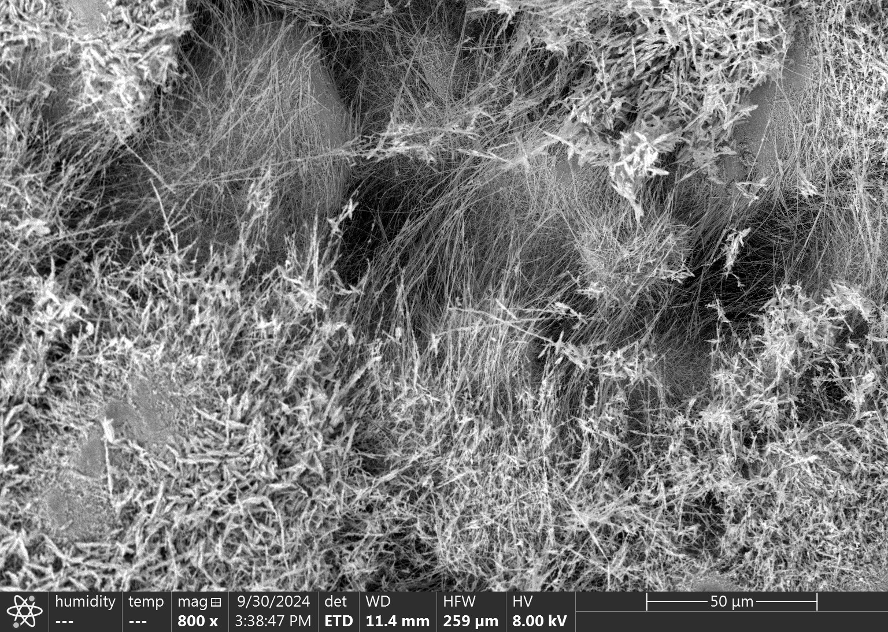
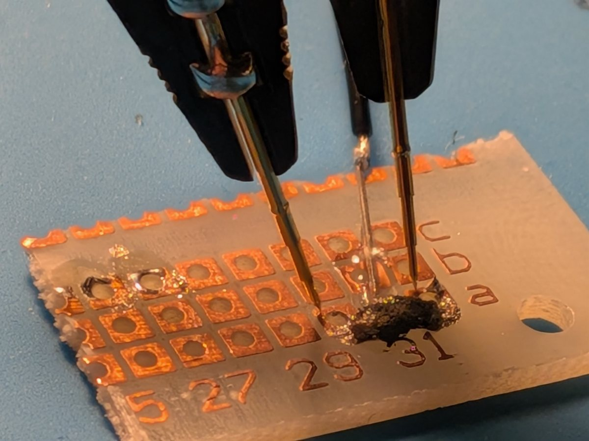
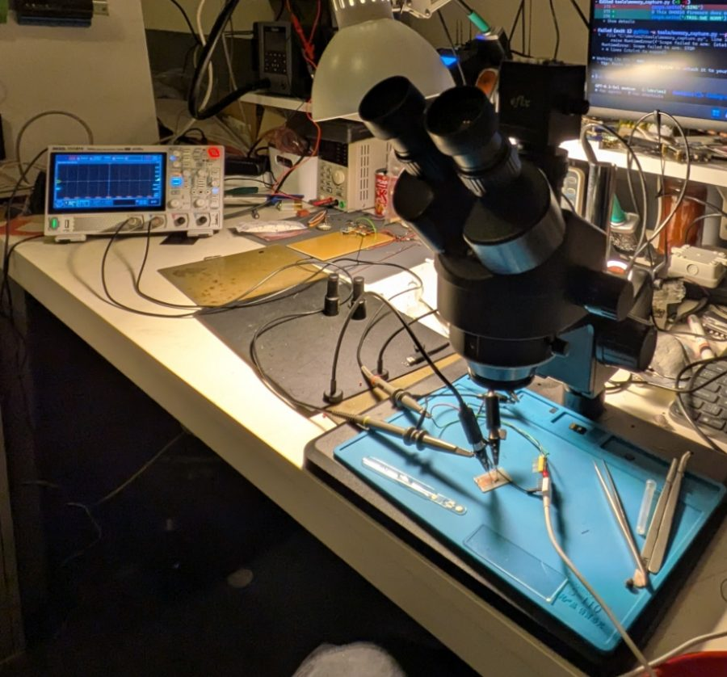

# Exhibition mode — operation

## How the measurements were made

The measurements were a guided experiment: a human connected the probes to the sample, and artificial intelligence handled the rest. An ESP32 microcontroller (GPIO4, nominal 0 / 3.3 V) sent the pulses and a Rigol DHO814 oscilloscope recorded them (CH2 the drive, CH1 the response). The first characterization was a conversation with an AI assistant (ChatGPT); the later memory experiments (millisecond screen and fast 10-500 µs sweep) were run by a coding agent (Codex) through the instrument interfaces. Every raw recording, calibration and log is in the lab repository https://git.tami.sh/yair/ws2. The screen says this in the "?" panel and on the finale card *An experiment guided by AI*. Check the wording with the lab before printing: the agent names come from the lab's own handoff notes.

## The real material



*WS₂ nanotubes under the scanning electron microscope (SEM), 800x, scale bar 50 µm. Image: Vojtěch Jeremiáš Kundrát, 30 Sep 2024 (original file `long WSe2 nanotubes7.tif`).*



*The real sample on a board with measuring probes. Photograph from the laboratory, 19 Oct 2026 (lab repository `yair/ws2`, `docs/images`). The lab notes that contact roles are described in its own wiring notes and are not inferred from the photograph.*



*The bench where it was measured: oscilloscope, microscope and the sample on the blue mat. Photograph from the laboratory, 19 Oct 2026.*

Where they appear on the screen: the sample on its board on the first card of the finale (Lovelace), the electron-microscope image on the last card (the letter to the nanotubes), the bench in the "?" panel. They are never shown as the simulation, and the screen always says they are photographs.

**Note on the file name:** the electron-microscope file is named `long WSe2 nanotubes7.tif`. That is a typo in the file name: the material is tungsten disulfide (WS₂), as confirmed by the project (not WSe₂, tungsten diselenide).


Everything here is the **public touchscreen installation** (`expo.html`). The original laboratory
application stays at `index.html` (header link "Expo" ↔ the lab; the lab page is Czech by default,
with an English switch). The exhibition mode contains **no Web Serial, no hardware control, no live
capture and needs no internet**.

## Start

1. Install Node.js (any current version) and Chrome on the exhibition computer.
2. Double-click `start-exhibition.bat`. It starts the local file server (`tools/serve.mjs`, port
   8080, localhost only) and opens Chrome in kiosk mode on `expo.html?kiosk=1`.
3. Exit: `Alt+F4`.

Manually: `node tools/serve.mjs` and open `http://127.0.0.1:8080/expo.html`.

## Placing the screen next to the apparatus

The signal column (oscilloscope + material network) belongs on the side of the physical apparatus.
Default: apparatus on the **right** (human column on the left, oscilloscope and visualisation on the
right). To mirror it open the page with `?side=left` (put it in the URL inside `start-exhibition.bat`);
the key **L** mirrors it for the current session only. Nothing is remembered by the browser.

## Behaviour

* Idle: the simulation runs by itself on random MNIST test digits. A touch anywhere starts drawing.
* After a drawing is sent, the run has four stages and waits at the end of each for the visitor to press **Dál**.
* After 45 s without touch while drawing or waiting at a **Dál**, or 50 s on the result, it returns to idle.
* Returning to idle resets the language to Czech. The `CS | EN` switch is in the top right.
* A frame watchdog reloads the page if animation stops for 15 s; four script errors within a minute
  also trigger a reload; one error returns to idle. A quiet reload happens after 6 hours of uptime,
  only when nobody has touched the screen for a minute.
* The top bar shows navigation from the result on (Výsledek · Co udělá světlo · Jak se rozhoduje · Budoucnost hmoty); the middle two are an advanced layer with the light experiment
  (train in the dark, test under light, retrain under light). It returns to idle by the same timeout.
* The navigation item "Budoucnost hmoty" opens the finale (six cards, speculation tagged
  as such, ending with the paper sheet's question).
* The advanced layer has two tabs: a live light dimmer with the visitor's own digit, and "how the readout
  layer decides" (each score as a sum of votes).
* The idle screen carries the installation's credits (`CREDITS` in `js/expo/copy.js`, taken from its
  official description) and a small note citing the source article.
* Nothing the visitor draws is saved or sent anywhere.

## Files

| File | Role |
|---|---|
| `expo.html`, `expo.css` | the one-screen page and its look |
| `js/expo/main.js` | phases, timing, idle, watchdogs |
| `js/expo/model.js` | the model: `js/reservoir.js` + the trained readout; `runDigit` |
| `js/expo/preprocess.js` | drawing → MNIST-style 28×28 → the dataset's own 8×8 reduction |
| `js/expo/draw.js`, `scope.js`, `material.js`, `pulse.js` | drawing surface, oscilloscope, network, pulse rails and bars |
| `js/expo/copy.js` | all visitor text, Czech first, English switch |
| `data/expo-readout.json` | readout trained offline on the **simulation** |
| `data/expo-light.json`, `data/expo-light-readouts.json`, `tools/light_experiment.mjs` | the light experiment (dark → light → retrain), measured on the simulation; the retrained readouts |
| `js/expo/deep.js`, `light.js`, `decide.js` | the advanced layer: live light dimmer, accuracy chart, "how the readout decides" |
| `tools/train_expo_readout.mjs` | regenerates the readout (`--compare` compares encodings) |
| `js/reservoir.js` | shared with the lab; one backward-compatible addition: an optional `onStep` callback |

## Checks

```
node test/test_expo_preprocess.mjs   # dataset recipe is exact; centring; accuracy through the whole pipeline
node test/test_expo_copy.mjs         # every on-screen text exists in Czech and English
```

## Honest limits

* The model is a simulation. The readout reaches 93.66 % on 10 000 held-out MNIST test digits;
  hand-drawn digits are less reliable and the screen says "není jistá" when the score margin is small.
* The slowed playback (≈ 120×) and the placement and colours of the network nodes are visual choices,
  stated on screen.
* If a different oscilloscope signal, a different material or measured data are ever shown on this
  screen, the badge and the footer text must be changed to say so. Today they say simulation.

## Voice (optional)

Every card of the finale has a "Poslechnout / Listen" button, and there is "Přečíst všechny domněnky" (read all the guesses aloud): the screen then turns the cards by itself, one after another, until the last. Nothing plays until it is tapped.

* Recordings come first: every card of the finale has a voice that reads its guess (the second half of the card, never the title). Put `card01_cs.mp3` ... `card15_cs.mp3` (and `_en`; also `.ogg` or `.wav`) into an `audio/` folder next to `expo.html`; the number is the card's position. A recorded human voice into headphones or a directional speaker is recommended.
* Without a recording the browser's own speech synthesis is used, but only with a voice installed on the PC (online voices are ignored, the exhibition is offline). On the development PC Chrome has "Microsoft Jakub" for Czech. If there is no voice and no file, the buttons simply do not appear.
* Reading aloud counts as activity: the screen does not reset to the idle state while a card is being read.

## Sound of the real sample (an experiment, not part of the exhibition screen)

`sound-lab.html` (open it from the local server) plays the simulation (left) beside recordings made from the lab's oscilloscope capture of 19 Oct 2026 (right). The files `audio/ws2_*.wav` and `data/ws2-measured.json` are generated by `tools/make_ws2_audio.py` from `RigolDSws2d0.csv` (not stored in the repository). The recordings contain the instrument too (mains hum, probe noise); they are never synchronised with the simulation.

## Main sections (top bar)

Four tabs sit in the top bar (the fourth, **200 odpovědí**, stacks the 200 recorded pulses like the plot of a pulsar, with colour, sound and touch; the same picture also exists on its own as `pulsar.html`): **Interaktivní simulace** (the drawing experience and, from the result, the two deep views Co udělá světlo and Jak se rozhoduje, which have their own sub-navigation), **Zvuky vzorku** (the oscilloscope capture of 19 Oct 2026, seen and heard; recorded, never live) and **Budoucnost hmoty** (the finale, 17 cards in four chapters). The small **?** opens the explanation of what is simulated. `sound-lab.html` now only points to the Zvuky vzorku tab.

## Link to the laboratory repository

The lab's data and code (the oscilloscope captures, the firmware, the experiment protocols and results) are at **https://git.tami.sh/yair/ws2** (data in Git LFS; use `git clone`, the web page itself is not reliable). The address is shown as plain text on the idle screen, in the "?" panel and in the Zvuky vzorku tab. It is deliberately not clickable: a kiosk must not navigate away from the exhibition.

## Phone version

`mobile.html` (with `mobile.css`, `js/mobile.js`) is a separate scrolling page for phones: the simulation, the recorded sounds, the stack of 200 answers, the finale cards with voice, and the credits. It reuses the installation's texts, model and data. `expo.html` sends narrow touch screens there by itself; `expo.html?desktop=1` and `?kiosk` stay on the installation. The offline venue build does not need it.
